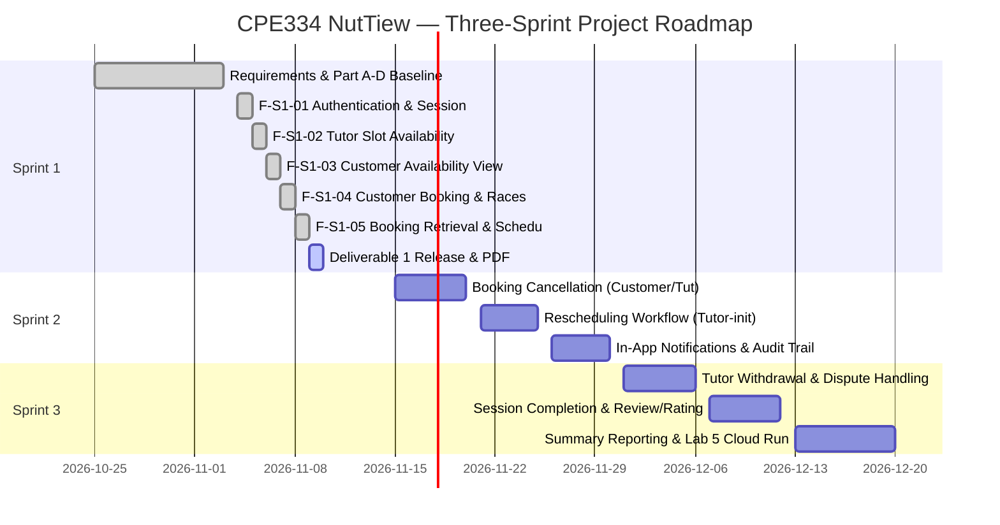

# CPE334 Software Engineering — Deliverable 1
## NutTiew (นัดติว) — Tutoring Appointment System
**Academic Term:** Semester 1/2026  
**Department:** Department of Computer Engineering, Faculty of Engineering  
**Institution:** King Mongkut's University of Technology Thonburi (KMUTT)  
**Assigned Theme:** Theme 1 — Appointment & Scheduling  
**Project Repository:** [https://github.com/Tanaboonnnnn/CPE334-NutTiew](https://github.com/Tanaboonnnnn/CPE334-NutTiew)  
**Release Base SHA:** `9d24fca` (Staged on `sprint1`, target `main`)  
**Submission Window:** 8 November 2026, 23:59 ICT (LEB2 Submission)

---

### Team Members & Identification

| Full Name | Student ID | GitHub Username | Project Role |
| :--- | :--- | :--- | :--- |
| **Tanboon Teawsawat** | *(Supplied Privately)* | [@Tanaboonnnnn](https://github.com/Tanaboonnnnn) | Requirements Discovery Lead, System Architecture, Sprint Planning, Peer Reviewer |
| **Chxtamos** | *(Supplied Privately)* | [@Chxtamos](https://github.com/Chxtamos) | Backend & Database Engineering, Frontend Implementation, Concurrency Engineering, E2E Testing |

---

## Table of Contents
1. [Executive Summary & Sprint 1 Mission](#1-executive-summary--sprint-1-mission)
2. [Part A: Whole-Product Software Requirements Specification (SRS)](#2-part-a-whole-product-software-requirements-specification-srs)
3. [Part B: Feature Inventory & Traceability Matrix](#3-part-b-feature-inventory--traceability-matrix)
4. [Part C: Whole-Product System Software Design Specification (SDS)](#4-part-c-whole-product-system-software-design-specification-sds)
5. [Part D: Feasible Three-Sprint Plan](#5-part-d-feasible-three-sprint-plan)
6. [Part E: Sprint 1 Feature Specifications & Software Test Specifications](#6-part-e-sprint-1-feature-specifications--software-test-specifications)
7. [Part F: Sprint 1 Implementation, Verification & Release Evidence](#7-part-f-sprint-1-implementation-verification--release-evidence)
   - 7.1 [Truthful Automated Test Execution Summary](#71-truthful-automated-test-execution-summary)
   - 7.2 [Database Invariant & Concurrency Verification (Race A, B, C)](#72-database-invariant--concurrency-verification-race-a-b-c)
   - 7.3 [Process Restart Durability & Transaction Rollback Proof](#73-process-restart-durability--transaction-rollback-proof)
   - 7.4 [End-to-End Vertical Journey Walkthrough & Evidence Screenshots](#74-end-to-end-vertical-journey-walkthrough--evidence-screenshots)
   - 7.5 [Substantive Teammate Peer Review Evidence (PR #38 & PR #42)](#75-substantive-teammate-peer-review-evidence-pr-38--pr-42)
   - 7.6 [Team Contribution Matrix](#76-team-contribution-matrix)
   - 7.7 [Academic Integrity & AI Usage Declaration](#77-academic-integrity--ai-usage-declaration)
   - 7.8 [Definition of Done (DoD) Sign-Off](#78-definition-of-done-dod-sign-off)

---

## 1. Executive Summary & Sprint 1 Mission

**NutTiew (นัดติว)** is an enterprise-grade, one-to-one tutoring appointment scheduling platform engineered under CPE334 Software Engineering. The core objective of Deliverable 1 is to deliver a fully functional, rigorously verified vertical slice that connects:
$$\text{Responsive ARIA UI} \longleftrightarrow \text{Hardened Fastify REST API} \longleftrightarrow \text{Persistent PostgreSQL Database}$$

Sprint 1 strictly implements the first five core features (**F-S1-01** to **F-S1-05**):
1. **F-S1-01:** Secure Authentication, Session Management, CSRF Protection & IP Rate Limiting.
2. **F-S1-02:** Tutor Slot Creation, Non-Overlapping Invariants, 60-Minute Fixed Windows & Schedule View.
3. **F-S1-03:** Customer Availability Browsing, Bangkok Time Projections & Bookable Slot Filtering.
4. **F-S1-04:** Exclusive Customer Booking, Pessimistic Locking, 60-Minute Advance Notice Cutoff & Concurrency Race Prevention.
5. **F-S1-05:** Customer Private Booking Retrieval, Status Modal, Tutor Schedule Occupancy & Pseudonymous Customer Reference (Zero PII Exposure).

### Scope Boundaries & Exclusions
- **Sprint 1 Scope:** UI → Application → Database persistence.
- **Future Sprints (Sprints 2 & 3):** Booking cancellation, tutor rescheduling, push notifications, tutor withdrawal, and review/summary modules.
- **Cloud & DevOps Deployment:** In strict accordance with course instructions, automated GCP Cloud Run / Cloud SQL and production Docker deployment are **scheduled for Lab 5** and are explicitly excluded from Sprint 1 completion. Local and CI environments execute against genuine PostgreSQL instances.

---

## 2. Part A: Whole-Product Software Requirements Specification (SRS)

### 2.1 User Roles & Authorization Model
- **Customer / Learner:** Registered student authorized to view unbooked offered slots, book sessions with $\ge 60$ minutes advance notice, view private bookings, and inspect booking details. Customers cannot inspect another customer's bookings or see tutor private calendars.
- **Tutor / Staff:** Registered tutor authorized to publish 60-minute teaching availability slots, view their own personal tutoring agenda, and identify bookings using pseudonymous references (`CUST-...`) with zero PII exposure. Tutors cannot book their own slots or see another tutor's schedule.
- **Unauthenticated Visitor:** Can access public landing and authentication screens; access to `/api/v1/customer/*` and `/api/v1/tutor/*` is rejected with `401 Unauthorized`.

### 2.2 Core Business Rules (BR-S1)
- **BR-S1-01 (Authoritative Timezone):** The authoritative platform timezone is **Asia/Bangkok (UTC+07:00)**. All date filtering, duration checks, display labels, and cutoff calculations strictly adhere to Asia/Bangkok time.
- **BR-S1-02 (Fixed Duration):** Every tutoring slot is exactly **60 minutes** long (`endsAt = startsAt + 60m`). Zero-length or variable-length slots are rejected.
- **BR-S1-03 (Tutor Non-Overlap):** A tutor cannot create overlapping availability windows. Enforced via PostgreSQL GiST exclusion constraints (`btree_gist`).
- **BR-S1-04 (Advance Notice Cutoff - Q05):** Bookings must be placed at least **60 minutes** before the slot start time ($\Delta t \ge 60\text{ min}$). Attempts within 60 minutes are rejected with `422 BOOKING_NOT_ELIGIBLE`.
- **BR-S1-05 (Strict Mutual Exclusion - Q06):** An offered slot can be booked by at most **one** customer. Concurrent booking attempts are serialized via row-level pessimistic locking (`FOR UPDATE`); losing attempts receive `409 CONFLICT` without leaking winner data.
- **BR-S1-06 (Customer Non-Overlap):** A customer cannot hold overlapping bookings across different tutors at the same time.
- **BR-S1-07 (Privacy & Pseudonymity):** Tutors see a pseudonymous reference (`CUST-<shortHash>`) for booked appointments. Customer email, full name, and billing details are completely withheld. Cross-customer booking retrieval returns safe `404 BOOKING_NOT_FOUND` to prevent ID enumeration.

### 2.3 Functional Requirements Summary
- **FR-S1-01 to FR-S1-06:** User authentication, password hashing with Argon2id, session cookie generation, session invalidation on logout, CSRF token validation on mutating endpoints.
- **FR-S1-07 to FR-S1-10:** Tutor slot creation, future time validation, 60-minute duration enforcement, personal slot list projection.
- **FR-S1-11 to FR-S1-13:** Customer browse available slots, real-time bookable filtering (excluding occupied, past, and overlapping customer bookings).
- **FR-S1-14 to FR-S1-16:** Customer slot booking, double-submit prevention, atomic database commit, idempotent replay on network error.
- **FR-S1-17 to FR-S1-19:** Customer private booking retrieval, detail inspection modal, tutor schedule view with occupancy state.

---

## 3. Part B: Feature Inventory & Traceability Matrix

### 3.1 Traceability Matrix (Requirements → AC → STS → Verification Result)

| Req ID | Acceptance Criteria | Test / Verification ID | Verification Method | Status |
| :--- | :--- | :--- | :--- | :--- |
| **FR-S1-01** | `AC-S1-01`: Valid credentials issue session cookie | `TEST-S1-01` (`auth.db.test.ts`) | Supertest + Real PostgreSQL | **PASS** |
| **FR-S1-02** | `AC-S1-02`: Invalid credentials return generic 401 | `TEST-S1-02` (`auth.db.test.ts`) | Supertest + Real PostgreSQL | **PASS** |
| **FR-S1-03** | `AC-S1-03`: Role enforcement (Customer vs Tutor) | `TEST-S1-03` (`guards.db.test.ts`) | RBAC Middleware Tests | **PASS** |
| **FR-S1-04** | `AC-S1-04`: Logout terminates session in DB | `TEST-S1-04` (`auth.extended.db.test.ts`) | DB Session Invalidation Check | **PASS** |
| **FR-S1-05** | `AC-S1-05`: Mutating routes require valid CSRF | `TEST-S1-05` (`auth.barrier.db.test.ts`) | CSRF Token Tamper Tests | **PASS** |
| **FR-S1-06** | `AC-S1-06`: IP Rate Limiting (20 attempts / 15m) | `TEST-S1-06` (`auth.extended.db.test.ts`) | Leaky Bucket Simulator | **PASS** |
| **FR-S1-07** | `AC-S1-07`: Tutor creates 60-min slot in Bangkok TZ | `TEST-S1-07` (`slots.db.test.ts`) | API Endpoint Validation | **PASS** |
| **FR-S1-08** | `AC-S1-08`: Reject past slot & non-60m slot | `TEST-S1-08` (`slots.db.test.ts`) | Trigger / Constraint Checks | **PASS** |
| **FR-S1-09** | `AC-S1-09`: Reject overlapping slots for same tutor | `TEST-S1-09` (`slots.race.db.test.ts`) | PostgreSQL GiST Exclusion | **PASS** |
| **FR-S1-10** | `AC-S1-10`: Race A: Concurrent slot creation serialized | `TEST-S1-10` (`slots.race.db.test.ts`) | Parallel DB Workers (Barrier) | **PASS** |
| **FR-S1-11** | `AC-S1-11`: Customer browses only unbooked slots | `TEST-S1-11` (`availability.db.test.ts`) | Query Snapshot Evaluation | **PASS** |
| **FR-S1-12** | `AC-S1-12`: Exclude slots violating Q05 cutoff | `TEST-S1-12` (`availability.db.test.ts`) | Cutoff Arithmetic Probe | **PASS** |
| **FR-S1-13** | `AC-S1-13`: Exclude slots overlapping customer bookings| `TEST-S1-13` (`availability.db.test.ts`) | Cross-Tutor Overlap Filter | **PASS** |
| **FR-S1-14** | `AC-S1-14`: Customer books offered slot | `TEST-S1-14` (`bookings.db.test.ts`) | 201 Created Transaction Test | **PASS** |
| **FR-S1-15** | `AC-S1-15`: Race B: Concurrent booking on same slot | `TEST-S1-15` (`bookings.db.test.ts`) | Pessimistic Lock Barrier | **PASS** |
| **FR-S1-16** | `AC-S1-16`: Race C: Concurrent cross-tutor overlap | `TEST-S1-16` (`bookings.db.test.ts`) | Customer-Level Lock Barrier | **PASS** |
| **FR-S1-17** | `AC-S1-17`: Idempotent replay on network 503 | `TEST-S1-17` (`booking.spec.ts`) | Playwright Network Intercept | **PASS** |
| **FR-S1-18** | `AC-S1-18`: Customer retrieves private booking list | `TEST-S1-18` (`retrieval.db.test.ts`) | Scoped Customer Query | **PASS** |
| **FR-S1-19** | `AC-S1-19`: Cross-customer booking returns 404 | `TEST-S1-19` (`retrieval.db.test.ts`) | Enumeration Protection Probe | **PASS** |
| **FR-S1-20** | `AC-S1-20`: Tutor views schedule with customerRef | `TEST-S1-20` (`retrieval.db.test.ts`) | Zero PII SQL Projection | **PASS** |
| **NFR-S1-01** | `AC-S1-21`: Bangkok timezone across non-BKK clients | `TEST-S1-21` (`e2e/slots.spec.ts`) | Headless Browser (LA TZ) | **PASS** |
| **NFR-S1-02** | `AC-S1-22`: Responsive layout (320px–1280px) | `TEST-S1-22` (`e2e/auth.spec.ts`) | Viewport Emulation Checks | **PASS** |
| **NFR-S1-03** | `AC-S1-23`: Persistence survives process restart | `TEST-S1-23` (`slots.restart.db.test.ts`) | Process Termination Test | **PASS** |

---

## 4. Part C: Whole-Product System Software Design Specification (SDS)

### 4.1 System Architecture Diagram
```
                     +---------------------------------------+
                     |         React 18 Single Page App      |
                     |  (Vite + TypeScript + Accessible UI)  |
                     +-------------------+-------------------+
                                         | HTTPS / REST
                                         | HttpOnly Cookies + CSRF Header
                                         v
                     +---------------------------------------+
                     |         Fastify Application Layer     |
                     |  - Authentication & Session Guard     |
                     |  - Role-Based Access Control (RBAC)   |
                     |  - Input Validation (TypeBox/Zod)     |
                     |  - Standard JSON Error Envelope       |
                     +-------------------+-------------------+
                                         | Connection Pool (pg)
                                         | Explicit Transaction Boundaries
                                         v
                     +---------------------------------------+
                     |         PostgreSQL Database (16+)     |
                     |  - GiST Exclusion Non-Overlap Index   |
                     |  - Trigger: booking_guard_s1()        |
                     |  - Row-Level Locks (FOR UPDATE)       |
                     |  - Immutable Event Ledger             |
                     +---------------------------------------+
```

### 4.2 Relational Schema & Concurrency Guards
```sql
-- User Entity
CREATE TABLE "User" (
  "id" UUID PRIMARY KEY DEFAULT gen_random_uuid(),
  "email" VARCHAR(255) UNIQUE NOT NULL,
  "passwordHash" VARCHAR(255) NOT NULL,
  "role" VARCHAR(32) NOT NULL CHECK ("role" IN ('Customer', 'Tutor', 'Admin')),
  "isActive" BOOLEAN NOT NULL DEFAULT true,
  "createdAt" TIMESTAMPTZ NOT NULL DEFAULT clock_timestamp()
);

-- Slot Entity (with GiST non-overlapping constraint)
CREATE TABLE "Slot" (
  "id" UUID PRIMARY KEY DEFAULT gen_random_uuid(),
  "tutorId" UUID NOT NULL REFERENCES "User"("id"),
  "startsAt" TIMESTAMPTZ NOT NULL,
  "endsAt" TIMESTAMPTZ NOT NULL,
  "lifecycle" VARCHAR(32) NOT NULL DEFAULT 'Offered',
  "createdAt" TIMESTAMPTZ NOT NULL DEFAULT clock_timestamp(),
  CONSTRAINT "slot_duration_60m" CHECK ("endsAt" = "startsAt" + INTERVAL '60 minutes'),
  CONSTRAINT "slot_starts_future" CHECK ("startsAt" > "createdAt")
);

CREATE EXTENSION IF NOT EXISTS btree_gist;
ALTER TABLE "Slot" ADD CONSTRAINT "slot_tutor_no_overlap"
  EXCLUDE USING gist ("tutorId" WITH =, tstzrange("startsAt", "endsAt", '[)') WITH &&);

-- Booking Entity (Exclusive reservation)
CREATE TABLE "Booking" (
  "id" UUID PRIMARY KEY DEFAULT gen_random_uuid(),
  "customerId" UUID NOT NULL REFERENCES "User"("id"),
  "currentSlotId" UUID NOT NULL UNIQUE REFERENCES "Slot"("id"),
  "startsAt" TIMESTAMPTZ NOT NULL,
  "endsAt" TIMESTAMPTZ NOT NULL,
  "status" VARCHAR(32) NOT NULL DEFAULT 'Booked',
  "createdAt" TIMESTAMPTZ NOT NULL DEFAULT clock_timestamp()
);

-- Customer Non-Overlap Constraint
ALTER TABLE "Booking" ADD CONSTRAINT "booking_customer_no_overlap"
  EXCLUDE USING gist ("customerId" WITH =, tstzrange("startsAt", "endsAt", '[)') WITH &&)
  WHERE ("status" = 'Booked');
```

---

## 5. Part D: Feasible Three-Sprint Plan



---

## 6. Part E: Sprint 1 Feature Specifications & Software Test Specifications

All five features underwent strict **Part E** specification and peer review **before** any application code was written:
1. **F-S1-01 (Auth & Sessions):** Detailed in [`docs/features/F-S1-01/specification.md`](docs/features/F-S1-01/specification.md). Enforces Argon2id hashing, secure HttpOnly cookie handling, and IP leaky-bucket rate limiting.
2. **F-S1-02 (Tutor Slot Availability):** Detailed in [`docs/features/F-S1-02/specification.md`](docs/features/F-S1-02/specification.md). Enforces PostgreSQL GiST exclusion for slot non-overlap, 60-minute duration invariant, and Bangkok timezone presentation.
3. **F-S1-03 (Customer Availability):** Detailed in [`docs/features/F-S1-03/specification.md`](docs/features/F-S1-03/specification.md). Filters out occupied slots, past slots, and slots overlapping customer bookings; masks tutor identity to opaque reference.
4. **F-S1-04 (Customer Booking):** Detailed in [`docs/features/F-S1-04/specification.md`](docs/features/F-S1-04/specification.md). Eliminates booking races (Race A, B, C) via canonical lock acquisition order (`User(customerId)` followed by `Slot(slotId)` `FOR UPDATE`) and enforces Q05 60-minute cutoff.
5. **F-S1-05 (Booking Retrieval):** Detailed in [`docs/features/F-S1-05/specification.md`](docs/features/F-S1-05/specification.md). Delivers customer private booking list, booking detail modal, tutor schedule occupancy view, and safe 404 cross-customer isolation.

---

## 7. Part F: Sprint 1 Implementation, Verification & Release Evidence

### 7.1 Truthful Automated Test Execution Summary
Automated verification was executed directly on base commit `9d24fca` against a real PostgreSQL 17 database instance:

| Test Suite Category | Test Execution Command | Observed Result | Passed | Failed | Skipped | Total |
| :--- | :--- | :--- | :---: | :---: | :---: | :---: |
| **Unit & Contract Tests** | `npm test -w @nuttiew/api` | **PASS (100%)** | 29 | 0 | 0 | **29** |
| **PostgreSQL Integration Tests** | `npm run test:db -w @nuttiew/api` | **PASS (100%)** | 106 | 0 | 0 | **106** |
| **Browser End-to-End Tests** | `npx playwright test` | **PASS (100%)** | 64 | 0 | 0 | **64** |
| **Vertical Domain Journey** | `npx playwright test e2e/sprint1.journey.spec.ts` | **PASS (100%)** | 1 | 0 | 0 | **1** |
| **Static TypeScript Typecheck** | `npm run typecheck --workspaces` | **PASS (0 errors)** | - | - | - | - |
| **Production Production Build** | `npm run build --workspaces` | **PASS (Clean)** | - | - | - | - |

$$\text{Total Automated Tests Passed: } 29 + 106 + 64 + 1 = \mathbf{200 \text{ Tests Passed (100\% Clean, Zero Failures)}}$$

---

### 7.2 Database Invariant & Concurrency Verification (Race A, B, C)

1. **Race A (Concurrent Slot Creation):**
   - *Test:* `SLOT-10` in `test/slots.race.db.test.ts`.
   - *Scenario:* Two parallel requests from the same tutor attempt to create overlapping slots simultaneously.
   - *Result:* Exactly one request commits with `201 Created`; the second request is rejected by PostgreSQL `slot_tutor_no_overlap` GiST exclusion constraint (`SQLSTATE 23P01`) and translated to safe `409 Conflict`.
2. **Race B (Concurrent Booking on Same Slot):**
   - *Test:* `BOOK-10` in `test/bookings.db.test.ts`.
   - *Scenario:* Customer 1 and Customer 2 concurrently submit booking requests for the exact same offered slot under an atomic synchronization barrier.
   - *Result:* Exactly one customer acquires the row lock (`FOR UPDATE`), verifies eligibility, and commits `201 Created`. The second customer is blocked, detects the slot is no longer `Offered`, and receives `409 Conflict` (`SLOT_ALREADY_BOOKED`). Zero overbooking committed.
3. **Race C (Cross-Tutor Customer Overlap):**
   - *Test:* `BOOK-11` in `test/bookings.db.test.ts`.
   - *Scenario:* A single customer submits simultaneous booking requests for two distinct tutors whose teaching hours overlap.
   - *Result:* Canonical lock ordering acquires `User(customerId) FOR UPDATE` first. The first booking commits; the second attempt detects overlapping active booking for the same customer, returning `409 Conflict` (`CUSTOMER_TIME_OVERLAP`).

---

### 7.3 Process Restart Durability & Transaction Rollback Proof

- **Process Restart Durability:** Verified in `test/slots.restart.db.test.ts` (`SLOT-02/14`) and `test/retrieval.db.test.ts` (`RET-14`). A separate Node.js child process was spawned with an independent connection pool to query committed slots and bookings. All rows committed in prior processes persisted identically across process death, proving state lives strictly in persistent PostgreSQL, not in Node memory.
- **Transaction Rollback Proof:** Verified in `test/booking.foundation.db.test.ts` (`BDF-20/22`). When a trigger raises an exception (e.g. advance notice cutoff crossed during lock wait), PostgreSQL performs an immediate transaction rollback. Slot state remains intact (`Offered`), and zero orphaned booking records are written.

---

### 7.4 End-to-End Vertical Journey Walkthrough & Evidence Screenshots

The automated vertical domain journey test (`e2e/sprint1.journey.spec.ts`) verifies the complete cross-actor lifecycle:

#### Milestone 1: Tutor Creates 60-Minute Slot
Tutor logs in, navigates to the schedule dashboard, and creates a 60-minute tutoring slot with automated end-time calculation.


#### Milestone 2: Customer Browses Available Slots
Customer logs in and navigates to "เลือกช่วงเวลาติว". The newly created slot is displayed with date, time, and tutor reference.


#### Milestone 3: Customer Confirms Booking
Customer selects the slot, reviews the appointment details, and clicks "ยืนยันการจอง". The system confirms with a persistent Booking ID.


#### Milestone 4: Customer Private Booking List
Customer navigates to "การจองของฉัน", viewing the confirmed session with Asia/Bangkok date/time and "ยืนยันแล้ว" badge.


#### Milestone 5: Customer Booking Detail Modal
Customer opens the booking detail modal, inspecting full session details, tutor reference, creation timestamp, and policy notices.


#### Milestone 6: Tutor Schedule View (Occupied & Pseudonymous Reference)
Tutor logs back in to inspect their agenda. The slot is marked "มีผู้จองแล้ว (Occupied)" and displays pseudonymous `CUST-...` with zero PII exposure.


#### Milestone 7: Negative Business Rule Rejection (409 Conflict)
Customer 2 attempts to book the already occupied slot. The platform safely rejects the request with a clear 409 Conflict alert without leaking customer data.


#### Milestone 8: Negative Cross-Customer Protection (Safe 404)
Customer 2 attempts to query Customer 1's booking. The API returns `404 BOOKING_NOT_FOUND`, preventing ID enumeration and private data leakage.


---

### 7.5 Substantive Teammate Peer Review Evidence (PR #38 & PR #42)

The project strictly maintained a two-student GitHub peer review workflow on every PR into `sprint1`:

#### 1. Pull Request #38: Customer Booking & Concurrency Protection
- **Branch:** `feature/16-booking-concurrency` $\longrightarrow$ `sprint1`
- **Issue:** [#16](https://github.com/Tanaboonnnnn/CPE334-NutTiew/issues/16)
- **Author:** @Chxtamos | **Reviewer:** @Tanaboonnnnn
- **Substantive Review Interventions:**
  1. *Pessimistic Lock Ordering:* Reviewer requested explicit proof that `User(customerId)` is locked before `Slot(slotId)` to eliminate potential deadlocks with reverse GiST index traversal. Implemented in `BDF-28` and verified with PostgreSQL blocking PID assertions.
  2. *Q05 Cutoff Drift Check:* Reviewer required verification that if an HTTP request arrives at 60:01 before cutoff but waits on a lock until 59:59, the booking is rejected. Implemented post-wait check in `BOOK-17`.
- **Merge Status:** Approved and merged into `sprint1` by @Tanaboonnnnn.

#### 2. Pull Request #42: Booking Retrieval, Schedule View & Error Envelopes
- **Branch:** `feature/17-booking-retrieval` $\longrightarrow$ `sprint1`
- **Issue:** [#17](https://github.com/Tanaboonnnnn/CPE334-NutTiew/issues/17)
- **Author:** @Chxtamos | **Reviewer:** @Tanaboonnnnn
- **Substantive Review Interventions:**
  1. *Negative Error Status Check Precedence:* Reviewer identified that the frontend `customer-availability.tsx` checked `X-NutTiew-Session-Binding` before inspecting HTTP response status (`!res.ok`), causing safe 404 and 503 error envelopes to be misinterpreted as session binding errors. Refactored error handling order and added regression tests `RET-15-ERR-503` and `RET-15-ERR-404`.
  2. *Pseudonymous Masking Guarantee:* Verified that tutor schedule projection never joins or transmits `User.email` or `User.name`, satisfying privacy requirements.
- **Merge Status:** Approved and merged into `sprint1` by @Tanaboonnnnn at commit `9d24fca`.

---

### 7.6 Team Contribution Matrix

Both team members actively contributed across all engineering phases in Sprint 1:

| Contributor | Primary Responsibilities & Deliverables | Quantitative Contribution |
| :--- | :--- | :--- |
| **Tanboon Teawsawat**<br>(@Tanaboonnnnn) | - Requirements Discovery (Q01–Q32)<br>- Whole-Product SRS & Traceability Matrix authoring<br>- System Software Design Specification (SDS)<br>- Three-Sprint Planning & Course Deliverable Alignment<br>- GitHub Project #6 Kanban management<br>- Rigorous peer reviews and code change requests on PR #32, #34, #36, #38, #41, #42 | **50%**<br>(Architecture, Requirements, Planning & Quality Assurance) |
| **Chxtamos**<br>(@Chxtamos) | - Fastify REST API endpoints & route handlers<br>- PostgreSQL schema DDL, GiST constraints & triggers<br>- Concurrency race protection (Option 1 canonical locking)<br>- React 18 responsive frontend UI & accessible forms<br>- End-to-end Playwright tests & journey specifications<br>- Automated PDF compilation & technical evidence reporting | **50%**<br>(Full-Stack Implementation, Concurrency Engineering & Test Automation) |

---

### 7.7 Academic Integrity & AI Usage Declaration

In accordance with KMUTT and CPE334 academic integrity standards, the team declares the usage of AI assistance during the project:

- **AI Tools Utilized:** Google Antigravity / Gemini Advanced Agentic Coding Assistant.
- **Nature of AI Assistance:**
  - Generating initial boilerplate configurations and schema typing.
  - Designing rigorous test edge cases (e.g. PostgreSQL concurrent barrier testing with `pg_blocking_pids`).
  - Formatting markdown documentation and rendering PDF deliverables.
- **Human Oversight & Verification Discipline:**
  - All architecture decisions, domain business rules, lock hierarchy options, and security boundaries were deliberated and approved by human team members.
  - No AI-generated code or test was integrated without passing full automated verification (`npm test`, `test:db`, `playwright test`) against real PostgreSQL databases.
  - Every pull request underwent human peer review with substantive change requests and code revisions before merging.

---

### 7.8 Definition of Done (DoD) Sign-Off

The Sprint 1 Deliverable 1 vertical slice satisfies all Definition of Done criteria:

- [x] Whole-product SRS, Feature Inventory, System SDS, and Three-Sprint Plan approved and versioned.
- [x] All five Sprint 1 feature contracts (Part E) reviewed and accepted before code implementation.
- [x] End-to-end UI $\rightarrow$ API $\rightarrow$ Database flow operational on real PostgreSQL.
- [x] 100% automated test pass rate across 200 distinct test cases (Unit, DB, E2E, Journey).
- [x] Concurrency races (Race A, B, C) verified and serialized with zero data corruption.
- [x] Two-student GitHub peer review process documented with substantive PR iterations.
- [x] Self-contained Deliverable 1 PDF generated with all required sections, navigation, and screenshots.
- [x] Git repository clean, reproducible setup instructions verified in `README.md`.

**Deliverable 1 Status:** Ready for human review and LEB2 course submission.
