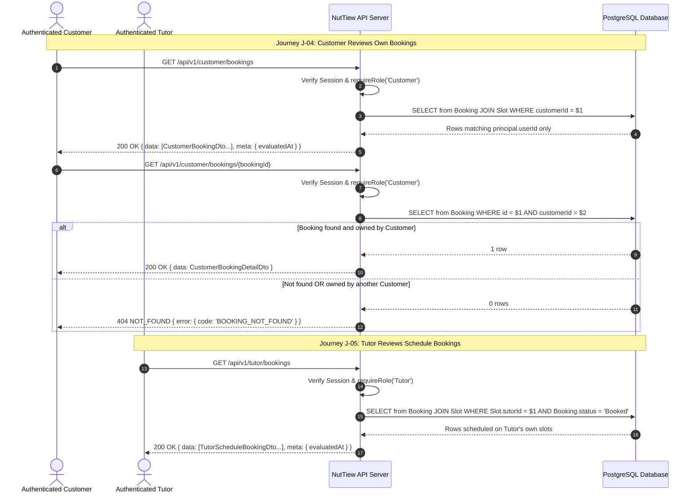

# F-S1-05 — Protected Booking Retrieval and Authorized Tutor Schedule Feature SDS (Part E)

> **Documentation contract only; not implemented, executed, or peer-approved yet.**
> Issue [#17](https://github.com/Tanaboonnnnn/CPE334-NutTiew/issues/17); provisional lead @Chxtamos; independent peer reviewer @Tanaboonnnnn.
> This Part E document specifies the data allowlists, authorization boundaries, UI/API contracts, and Software Test Specification (STS) for Sprint 1 Booking retrieval and Tutor schedule inspection. This change does not implement UI/API code, add a migration, execute tests, or close the issue.

---

## 1. Authority, Baseline, and Mission

### 1.1 Source Hierarchy
This specification derives from and complies with:
1. **[Sprint 1 Requirements](../../requirements.md):**
   - Functional requirements: `FR-S1-04`, `FR-S1-07`, `FR-S1-14`, `FR-S1-15`, `FR-S1-16`, `FR-S1-17`, `FR-S1-18`, `FR-S1-19`.
   - Business rules: `BR-S1-01`, `BR-S1-14`, `BR-S1-15`, `BR-S1-16`, `BR-S1-17`, `BR-S1-18`, `BR-S1-22`.
   - Non-functional requirements: `NFR-S1-01` (Record-level privacy), `NFR-S1-02` (Transport security), `NFR-S1-03` (Persistence integrity), `NFR-S1-07` (Bangkok timezone consistency), `NFR-S1-08` (Minimal payload disclosure), `NFR-S1-12` (Accessibility & WCAG tokens).
   - Acceptance criteria: `AC-S1-30`, `AC-S1-31`, `AC-S1-32`, `AC-S1-33`, `AC-S1-34`.
   - Planned validation anchors: `VC/TEST-S1-28`, `VC/TEST-S1-29`, `VC/TEST-S1-30`, `VC/TEST-S1-31`, `VC/TEST-S1-32`.
   - Direct stakeholder decisions: `Q01` (Single booking), `Q02` (Role authorization), `Q04` (60m duration), `Q05` (Cutoff lead time), `Q28` (Overlap rules), `Q29` (Asia/Bangkok display), `Q30` (Booked vs Past status, never Completed in S1).
2. **[Whole-product SRS](../../srs.md):** System actors, user journeys `J-01` (Auth), `J-02` (Tutor publishing), `J-03` (Customer booking), `J-04` (Customer booking review), `J-05` (Tutor schedule review).
3. **[System SDS](../../system-sds.md):** §§3.2–3.3 (Data entity relations), §4 (API conventions and error envelopes), §5 (Role & record level authorization), §6 (Timezone handling in UTC on wire and Asia/Bangkok on display).
4. **Accepted Preceding Contracts:**
   - [Auth F-S1-01](../F-S1-01/specification.md): Session cookie, identity, role guard, rate limiting, and CSRF token.
   - [Tutor Availability F-S1-02](../F-S1-02/specification.md): Owned 60-minute Slots, `startsAt`/`endsAt`, `lifecycle = 'Offered'`.
   - [Customer Availability Discovery F-S1-03](../F-S1-03/specification.md): Bookable Slot filtering, `T_view` evaluation, opaque Tutor references.
   - [Booking Data Foundation D1-08A/B](../../foundations/booking-data/specification.md): Canonical `Booking` table, `booking_guard_s1()` trigger, GiST exclusion constraints, and pre-index `User` lock (`da17acf`).
   - [Exclusive Booking F-S1-04](../F-S1-04/specification.md): SERIALIZABLE adapter, natural-key replay, committed `Booked` status.

### 1.2 Repository Baseline
- Integration base: `origin/sprint1` at commit [`ed78bbad9da8c828e9b0bd1c79ea8f68f553c9b1`](https://github.com/Tanaboonnnnn/CPE334-NutTiew/commit/ed78bbad9da8c828e9b0bd1c79ea8f68f553c9b1), containing all merged foundations:
  - Auth implementation (PR #26)
  - Tutor Slots & Dashboard (PR #28, PR #31)
  - Shared Booking Data Foundation (PR #36) & Remediation (PR #40)
  - Customer Availability Discovery (PR #37)
  - Customer Exclusive Booking & BDF-23 (PR #38)

---

## 2. Mission and Core Outcomes

### 2.1 The Two Primary User Outcomes
1. **Customer-Private Booking Review (`FR-S1-14`, `AC-S1-30`, `AC-S1-31`):**
   An authenticated Customer can retrieve a complete list of their **own** committed Bookings and open individual Booking details after browser refresh or application restart. The details display Booking ID, Slot ID, Tutor reference/identity, appointment interval in Asia/Bangkok time, and business status (`Booked` or time-derived `Past`). No unauthorized Customer or anonymous caller can read or discover any private Booking payload.
2. **Authorized Tutor Schedule Inspection (`FR-S1-07`, `FR-S1-15`, `AC-S1-32`, `AC-S1-33`):**
   An authenticated Tutor can inspect the collection of Slots and associated Bookings on their **own** authorized schedule. The Tutor schedule view projects each Slot's occupancy state (`Unoccupied` vs `Occupied`) and lists active Bookings assigned to their schedule without leaking other Tutors' restricted schedule records or foreign Customer data.

### 2.2 Time-Derived Classification: "Past" is NOT "Completed" (`FR-S1-17`, `BR-S1-14/22`, `AC-S1-34`, `Q30`)
- In Sprint 1, the database business status of an active appointment is always `'Booked'` (or `'Cancelled'` in future sprints).
- When the appointment window has elapsed (`endsAt <= clock_timestamp()`), the UI and API may classify the presentation as **`Past`**.
- **Strict Invariant:** An elapsed appointment **MUST NOT** be automatically updated to `'Completed'`, marked as attended, canceled, or released back to the bookable pool. The persisted database row remains `status = 'Booked'`, and the Slot remains occupied.

---

## 3. Boundaries and Scope

### 3.1 In Scope for Sprint 1 (F-S1-05)
- **Customer Endpoints:**
  - `GET /api/v1/customer/bookings`: Returns all Bookings belonging strictly to `principal.userId`.
  - `GET /api/v1/customer/bookings/:id`: Returns single Booking detail if owned by `principal.userId`; returns `404 BOOKING_NOT_FOUND` if non-existent or owned by another user.
- **Tutor Endpoints:**
  - `GET /api/v1/tutor/slots`: Updated to project dynamic occupancy (`Occupied` if an active `Booked` row exists on that Slot, else `Unoccupied`).
  - `GET /api/v1/tutor/bookings`: Returns all active Bookings scheduled on Slots owned by `principal.userId`.
- **Backend Record-Level Security:**
  - All ownership filters are strictly bound to `principal.userId` from the authenticated session; never trust client-supplied IDs, query parameters, or route tampering.
  - Fail closed on unauthorized access: anonymous calls return `401 UNAUTHENTICATED`; role mismatches return `403 FORBIDDEN`; foreign record queries return `404 BOOKING_NOT_FOUND` (preventing ID enumeration).
- **Time Handling:**
  - Wire timestamps: Strict ISO 8601 / RFC 3339 UTC strings ending in `Z` with milliseconds (e.g., `YYYY-MM-DDTHH:mm:ss.sssZ`).
  - Evaluation timestamp: API returns `meta.evaluatedAt` representing server-authoritative time used for the `displayStatus` derivation.
  - UI Presentation: Formatted strictly in `Asia/Bangkok` timezone (UTC+7) regardless of local device timezone.
- **Durable Persistence Proof:**
  - Data retrieval queries committed rows from PostgreSQL database tables (`Booking`, `Slot`, `User`).
  - Persistence holds across app restart and browser reloads.

### 3.2 Explicitly Out of Scope for Sprint 1
- **No Mutation:** F-S1-05 is strictly a read-only retrieval feature; it performs zero database `INSERT`, `UPDATE`, `DELETE`, or schema DDL.
- **No Sprint 2/3 Capabilities:**
  - Customer cancellation (`Q07–Q08`) or rescheduling (`Q09–Q16`).
  - Tutor withdrawal reasons, cancellations, or slot modifications (`Q17–Q20`, `Q26–Q27`, `Q32`).
  - In-app notification center or email delivery (`Q21–Q25`).
  - Tutor appointment summary dashboard with attendance tracking (`Q31`).
  - Review, rating, messaging, payments, or attendance logging.
- **No Unapproved Query Parameters:** No filtering, search, pagination, date-range bounding, or custom sorting is approved for Sprint 1. Requests with unexpected query parameters fail with `400 INVALID_INPUT`.

---

## 4. User Journeys and Actors

---

## 5. Architectural Invariants and Decisions

| Decision / Invariant ID | Summary | Rationale & Enforcement |
|---|---|---|
| **INV-RET-01: Session-Bound Ownership** | All read queries filter strictly by `principal.userId` extracted from the server-validated session. | Client cannot forge or query other users' data. URL tampering produces `404` or `403`. |
| **INV-RET-02: Safe Enumeration Refusal (404 instead of 403)** | If a Customer requests `/api/v1/customer/bookings/:id` for an ID that exists but belongs to someone else, return `404 BOOKING_NOT_FOUND`. | Returning `403 FORBIDDEN` confirms the ID exists in the system (information leakage). `404` prevents ID brute-forcing. |
| **INV-RET-03: No Phantom Completion** | Elapsed appointments (`endsAt <= clock_timestamp()`) have `displayStatus = 'Past'`, while `status = 'Booked'`. | Adheres strictly to `Q30`, `FR-S1-17`, and `BR-S1-22`. Sprint 1 does not implement attendance or completion. |
| **INV-RET-04: Dynamic Slot Occupancy** | `listOwnSlots` determines `occupancy` via an active `Booked` record matching `Booking.currentSlotId = Slot.id`. | Delivers `FR-S1-07` without adding a mutable `Slot.isBooked` column, preserving single-source-of-truth normalization. |
| **INV-RET-05: Strict UTC Wire Normalization** | Timestamps returned by the API are normalized to UTC with trailing `Z`. | Eliminates ambiguity caused by database server or runtime timezone settings (`NFR-S1-07`). |
| **INV-RET-06: Strict Query Allowlist** | Query strings are forbidden (`Object.keys(req.query).length === 0`). | Prevents SQL injection, parameter pollution, and unapproved filtering features (`NFR-S1-08`). |
| **INV-RET-07: Minimal Payload Privacy** | Responses exclude password hashes, CSRF nonces, session digests, and unapproved contact data. | Strict DTO allowlists satisfy `NFR-S1-01` and `NFR-S1-08`. |

---

## 6. Acceptance Criteria and Traceability Matrix

| Requirement ID | Acceptance Criteria | Business Rule | Verification Anchor | Description |
|---|---|---|---|---|
| `FR-S1-14`, `FR-S1-16` | **AC-S1-30** | `BR-S1-01`, `BR-S1-15` | `VC/TEST-S1-28` | Customer retrieves own list/detail after refresh/restart with exact Booking ID, Tutor, Bangkok interval, and status. |
| `FR-S1-04`, `FR-S1-14` | **AC-S1-31** | `BR-S1-15`, `BR-S1-18` | `VC/TEST-S1-29` | Customer B attempts to view Customer A's Booking ID; API returns safe `404 BOOKING_NOT_FOUND` with zero data leakage. |
| `FR-S1-07`, `FR-S1-15` | **AC-S1-32** | `BR-S1-16` | `VC/TEST-S1-30` | Tutor views Bookings on own schedule; occupied slots display `Occupied`; only assigned Bookings are visible. |
| `FR-S1-04`, `FR-S1-15` | **AC-S1-33** | `BR-S1-16`, `BR-S1-18` | `VC/TEST-S1-31` | Tutor B attempts to read Tutor A's schedule/bookings; access denied, zero foreign records disclosed. |
| `FR-S1-17` | **AC-S1-34** | `BR-S1-14`, `BR-S1-22` | `VC/TEST-S1-32` | An elapsed appointment displays as `Past`, but persisted business state remains `Booked`, never `Completed`. |

---

## 7. Definition of Done (DoD)

### Part E — Specification Stage (Current PR)
- [ ] Complete `specification.md`, `api-spec.md`, `ui-spec.md`, `data-spec.md`, and `tests.md` authored under `docs/features/F-S1-05/`.
- [ ] Invariants, request/response DTO schemas, and error codes strictly mapped to requirements and existing architecture.
- [ ] No application code, migrations, or tests implemented in this documentation PR.
- [ ] Peer review requested from @Tanaboonnnnn and approved before branching Part F.

### Part F — Implementation Stage (Subsequent Work)
- [ ] Backend route handlers, services, and queries implemented for Customer bookings and Tutor schedule views.
- [ ] Tutor own-slots list updated to project dynamic occupancy from committed `Booking` rows.
- [ ] Customer and Tutor UI components connected to live API endpoints.
- [ ] STS test suite `RET-01..RET-16` executed with real PostgreSQL and Playwright browser, achieving 100% PASS.
