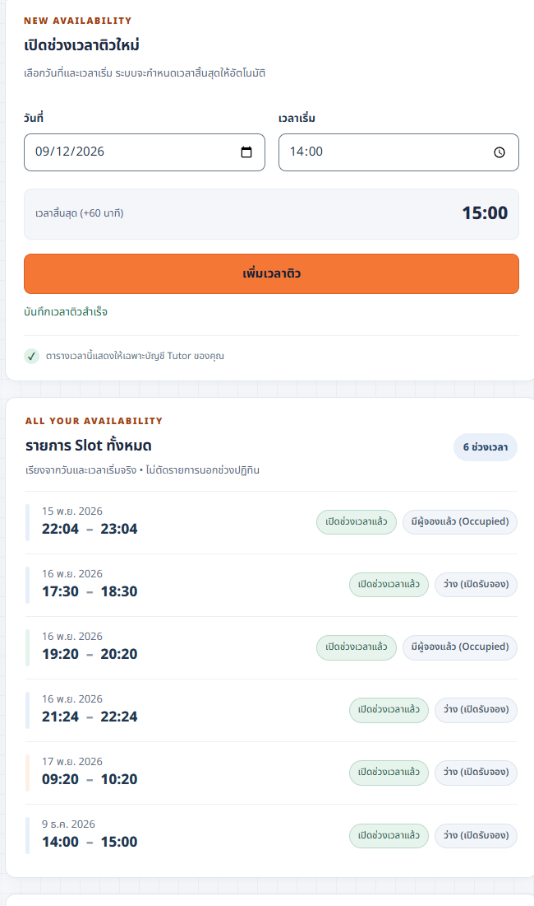
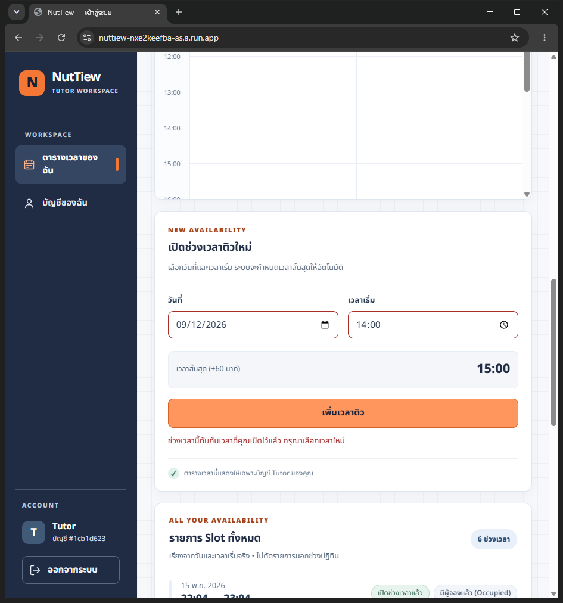
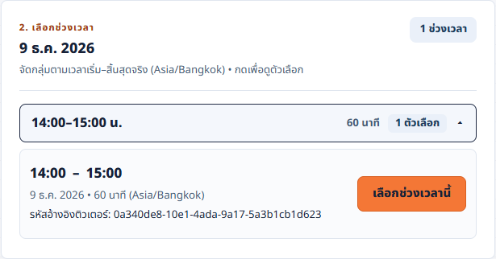
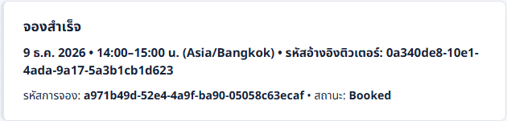
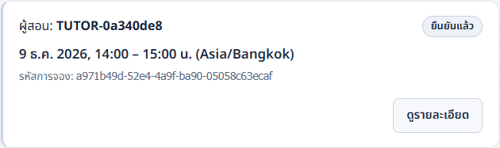
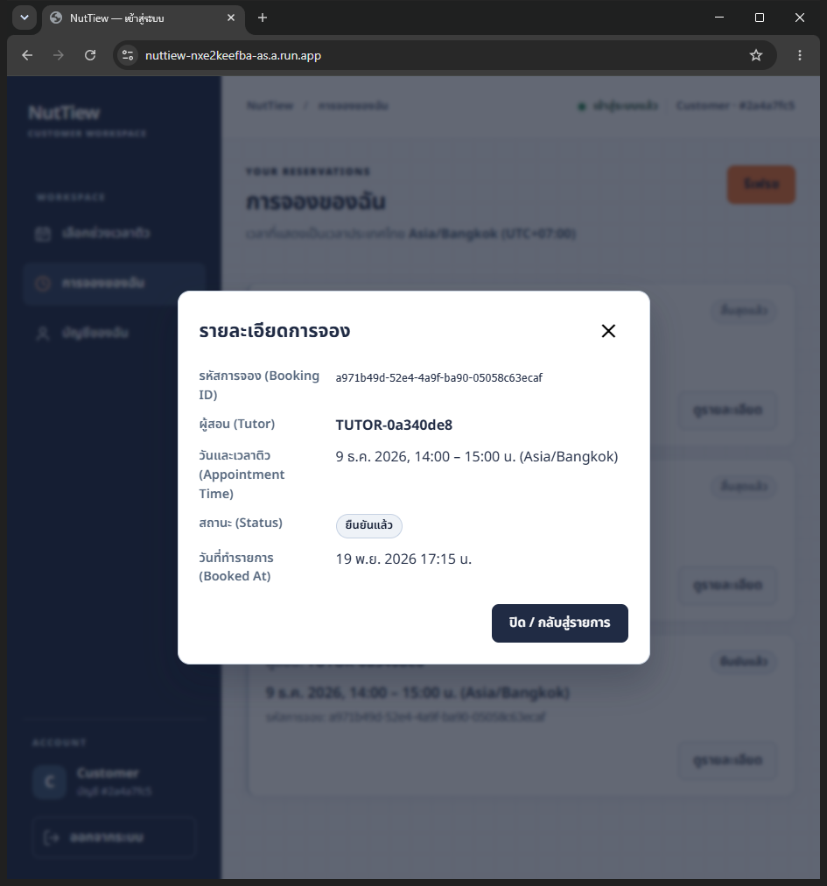
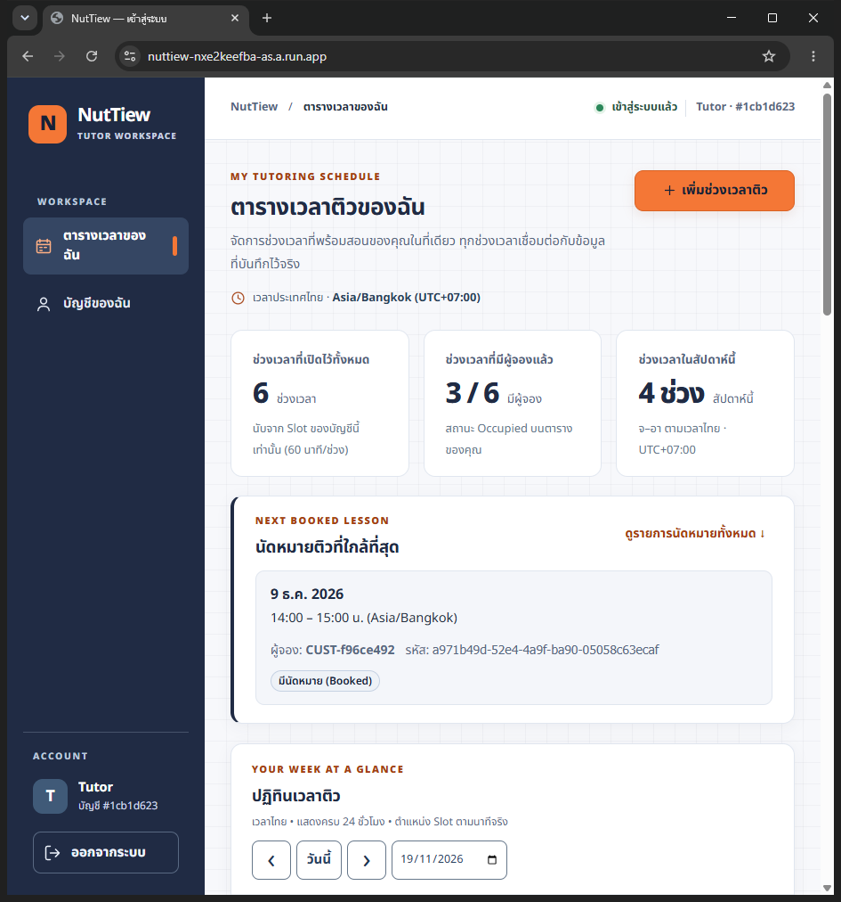

# Lab 5 C-04: Live Tutor and Customer workflow (NutTiew)

- **Verification date:** 19 November 2026 (Asia/Bangkok)
- **Rubric:** C-04 / R-03, Lab 5 handout Section 8 (p. 7), Answer Part 3 (p. 9)
- **Public production URL:** https://nuttiew-nxe2keefba-as.a.run.app/
- **Application source:** protected `main` release `ff55ac766ca792f0cc3ae29adad39d71ea4bca11`
- **Verified deployment:** [CD run #44455509285](https://github.com/Tanaboonnnnn/CPE334-NutTiew/actions/runs/44455509285), Cloud Run revision `nuttiew-00006-sen`, image digest `sha256:ac1c9b0eb8e77d3245982ede48f5917494bfd020c6755134836da684db5d996e`
- **Related issue:** [#64: First GCP deployment / C-04](https://github.com/Tanaboonnnnn/CPE334-NutTiew/issues/64)

## Test method and nonsecret test identifiers

A human-visible Playwright CLI browser was used against the actual public Cloud Run origin (not a local or mocked application). UI interactions used existing, manually configured demo accounts, one `Tutor` and one `Customer`. There is no public registration feature; the accounts had been provisioned before this test. No account password, session cookie, API token, Cloud SQL credential, or Secret Manager value is recorded in this evidence.

- Demo tutor: `tutor.demo@example.test`; public UI identity suffix `#1cb1d623`.
- Demo customer: `customer.demo@example.test`; public UI identity suffix `#2a4a7fc5`.
- Test lesson (Asia/Bangkok): **2026-12-09, 14:00-15:00** (60 minutes).
- Confirmed test **Booking ID**: `a971b49d-52e4-4a9f-ba90-05058c63ecaf`.
- Pseudonymous Customer reference visible to Tutor: `CUST-f96ce492` (not the customer's email).

The screenshots with suffix `-url.png` are captures of the **real Chrome window**, including its production address bar. The smaller close-ups are direct Playwright page/element screenshots from the same live test session. Neither kind is a mockup or a reconstructed interface.

## Live C-04 test results

| Test | Actual observed result | Outcome | Evidence |
| --- | --- | --- | --- |
| C04-01 Public entry and DB-backed readiness | Public `/` and `/api/ready` responded HTTP 200; readiness body was `{"status":"ready"}`. Successful Cloud Run migration/revision is traceable in CD run #44455509285. | **PASS** | Production URL; CD run |
| C04-02 Anonymous access control | Unauthenticated `GET /api/v1/auth/me`, `/api/v1/tutor/slots`, `/api/v1/customer/availability`, and `/api/v1/customer/bookings` returned HTTP **401**. | **PASS** | Read-only HTTP request observations |
| C04-03 Tutor sign-in | Existing Tutor account signed in via real Production UI, showing a role-scoped Tutor workspace and its own persisted slots and bookings. | **PASS** | [Tutor URL view](images/c04-07-tutor-booking-url.png) |
| C04-04 Tutor creates an available slot | Tutor submitted the **2026-12-09 14:00-15:00** slot in the UI. Successful creation shown in the list, with total slots increasing from **5 to 6**. | **PASS** | [Created slot](images/c04-01-tutor-slot-created.png) |
| C04-05 Tutor domain rule rejection | A second attempt to create the identical Tutor slot was **rejected**, with the visible overlapping-time error. The total remained **6** (no duplicate). This was observed both in the initial test and a later screenshot recheck. | **PASS** | [Rejected overlap with public URL](images/c04-02-tutor-overlap-rejected-url.png) |
| C04-06 Customer sign-in and discovery | Existing Customer account signed in. The Customer calendar showed **one available option** on 9 Dec at **14:00-15:00**, referencing the same Tutor. | **PASS** | [Customer available slot](images/c04-03-customer-availability.png) |
| C04-07 Customer books slot | Customer selected that offer, reviewed the selection, then confirmed. UI showed **Booked** and returned Booking ID `a971b49d-52e4-4a9f-ba90-05058c63ecaf`. | **PASS** | [Successful booking](images/c04-04-customer-booking-confirmed.png) |
| C04-08 Customer's private booking retrieval | The same Booking ID and time appeared in **My bookings**, in the private detail dialog, and again after an ordinary page reload. | **PASS** | [Private booking row](images/c04-05-customer-private-booking.png); [detail and public URL](images/c04-06-customer-detail-url.png) |
| C04-09 Role restriction: Customer -> Tutor | Authenticated Customer attempted read-only `GET /api/v1/tutor/slots`; API returned **403 Forbidden**. | **PASS** | Observed browser HTTP result |
| C04-10 Tutor sees the new booking | Signing in as Tutor again showed **3 of 6 slots occupied** (previously 2 of 5), the Dec 9 lesson marked **Booked / Occupied**, the same Booking ID, and only a pseudonymous customer reference. | **PASS** | [Tutor schedule and public URL](images/c04-07-tutor-booking-url.png) |
| C04-11 Role restriction: Tutor -> Customer | Authenticated Tutor attempted read-only `GET /api/v1/customer/bookings`; API returned **403 Forbidden**. | **PASS** | Observed browser HTTP result |
| C04-12 Session cleanup | The session was signed out after testing. No additional live deployment, schema migration, IAM change, test fixture import, or new paid GCP resource was performed for this C-04 walkthrough. | **PASS** | Browser sign-out observation |

**C-04 conclusion:** **PASS** for the public Tutor -> API -> database-backed Customer discovery -> booking -> private retrieval -> Tutor schedule journey, with domain-rule rejection and cross-role authorization denials. This is an actual end-user UI walkthrough backed by the published Production service; it is not merely an automated CI unit test.

## Photo index for Answer Part 3

1. **C04-F01: Tutor creates a 60-minute slot.** [Slot list item showing 9 Dec 2026, 14:00-15:00 and available status](images/c04-01-tutor-slot-created.png).

   

2. **C04-F02: Negative domain case / URL proof.** [Browser screenshot showing public URL, overlap rejection, and total slot count still six](images/c04-02-tutor-overlap-rejected-url.png).

   

3. **C04-F03: Customer discovers Tutor availability.** [Visible offered 9 Dec slot from the live Customer calendar](images/c04-03-customer-availability.png).

   

4. **C04-F04: Customer books successfully.** [Booked status and booking ID immediately after confirmation](images/c04-04-customer-booking-confirmed.png).

   

5. **C04-F05: Private Customer booking list.** [Customer's own booking appears with same identifier](images/c04-05-customer-private-booking.png).

   

6. **C04-F06: Customer detail with production URL.** [Real Chrome address bar and Booking ID, confirmed status and Bangkok timestamp in the detail view](images/c04-06-customer-detail-url.png).

   

7. **C04-F07: Tutor sees the Customer's booking, with public URL.** [Tutor dashboard with latest lesson, same Booking ID, pseudonymous customer and 3/6 occupied count](images/c04-07-tutor-booking-url.png).

   

## Provenance and boundaries

- The only new persistent application test data were **one Tutor Slot** and **one Customer Booking**. The attempted duplicate Slot was refused; further checks used reads, sign-ins, and sign-outs. Existing data was not deleted or reset.
- The Customer booking record survived **an ordinary browser reload and new sign-in**. This is NOT an application **restart**, NOT a Cloud Run **redeploy**, and does **not** satisfy **C-05** by itself. Preserve the Booking ID above to compare the same record before and after a separately authorized restart and a later approved release.
- UI screenshots prove visible workflow and role-specific state; HTTP 401/403 observations prove API access checks. The Cloud Run release log proves the previously reviewed image/digest and migration. These observations do **not** replace a direct Cloud SQL Console screenshot for final Answer Part 3 if the TA wants to see the database resource itself.
- Chrome may abbreviate `https://` in its address bar; the visible hostname in C04-F02/F06/F07 is the exact production hostname above. No screenshot was relabelled, fabricated, or annotated to simulate a URL.
- Lab 5 C-03 Docker reproducibility, C-01/C-02 merge gates, and C-06 release evidence are separately documented in this repository; they were **not** rerun here.

**For the final Lab 5 PDF:** use the concise results in this file under `Answer Part 3: GCP Deployment and Persistence`, citing this live Production URL, Booking ID (test record), screenshots F02/F06/F07 (showing hostname) and select close-ups F01/F03/F04. Do not mark C-05 PASS until the actual before/after restart **and** redeploy observations have been made.