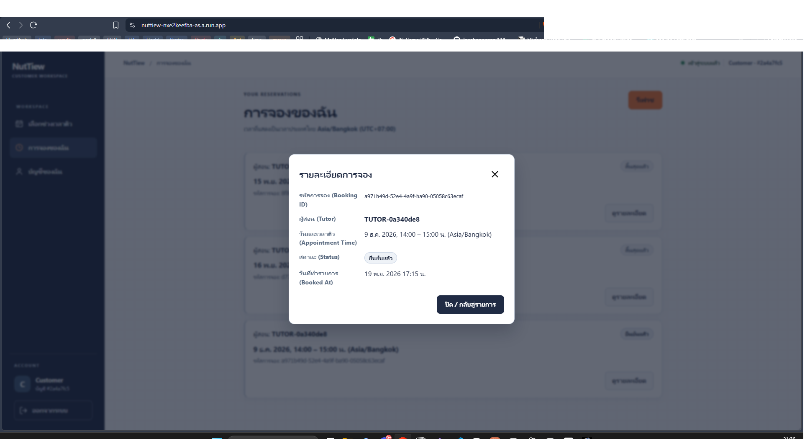
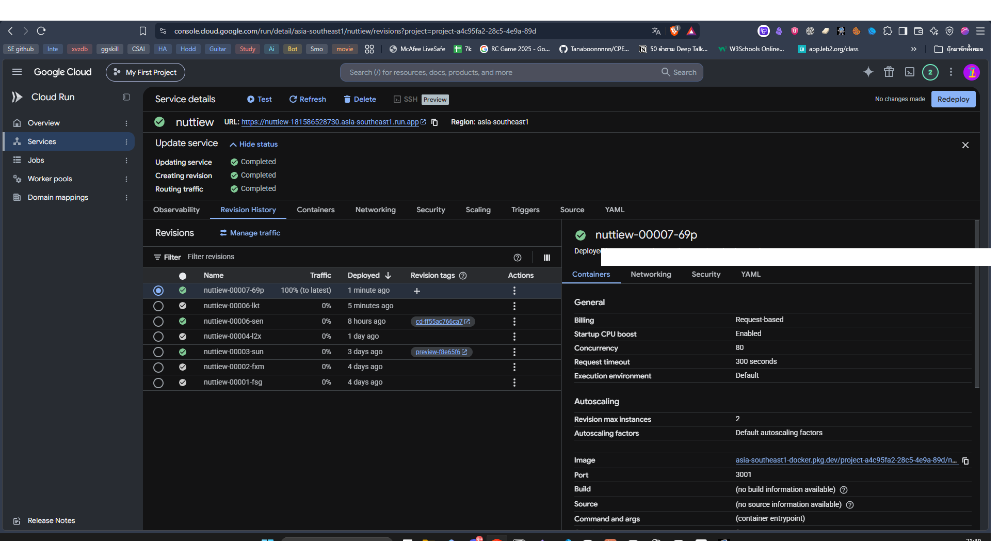

# Lab 5 C-05 — Live Booking Persistence Across Cloud Run Revisions

**Checked:** 19 November 2026 (Asia/Bangkok)

**Requirement:** R-04 / C-05, Lab 5 Handout §8 and Answer Part 3

**Production origin:** https://nuttiew-nxe2keefba-as.a.run.app/

**Service:** Cloud Run `nuttiew`, `asia-southeast1`

**Persistent store:** Cloud SQL PostgreSQL `nuttiew-pg` (observed `RUNNABLE`)

**Source release:** protected `main` commit `ff55ac766ca792f0cc3ae29adad39d71ea4bca11`
**Prior release proof:** [successful CD run #44455509285](https://github.com/Tanaboonnnnn/CPE334-NutTiew/actions/runs/44455509285) and [C-04 live workflow, PR #101](https://github.com/Tanaboonnnnn/CPE334-NutTiew/pull/101).

## 1. Fixed record and comparison method

The check reused **the same booking created during C-04**; it did **not** create, edit, cancel, reseed, or delete a booking.

| Attribute | Before and after |
| --- | --- |
| Booking ID | `a971b49d-52e4-4a9f-ba90-05058c63ecaf` |
| Tutor pseudonym | `TUTOR-0a340de8` |
| Appointment | 9 December 2026, 14:00–15:00, Asia/Bangkok |
| Status | **Confirmed / ยืนยันแล้ว** |
| Booked-at shown in UI | 19 November 2026, 17:15 Asia/Bangkok |

The tester signed in with an existing **synthetic Customer account** through the actual public UI, opened **My bookings**, and inspected this Booking ID. After each new application revision reached **100% traffic**, the tester fully reloaded the browser, navigated to My bookings again, and reopened the same record. All checks used the same public Production origin. No mock database was used.

## 2. Observed revision and persistence results

| Check | Operation and observed revision | Booking result | Outcome |
| --- | --- | --- | --- |
| C05-01 Before | Existing approved CD release: `nuttiew-00006-sen`, 100% traffic | Booking ID/time/status present; original [C04-F06 screenshot](images/c04-06-customer-detail-url.png) and live recheck | **PASS** |
| C05-02 Application replacement (restart-equivalent) | In Cloud Run Console, **Redeploy** with **no configuration changes**, serve immediately; new `nuttiew-00006-lkt` reached 100% traffic | Same Booking ID, Tutor, appointment and Confirmed status after reload | **PASS** |
| C05-03 Second redeploy | Repeated independent Cloud Run Console **Redeploy**, still **no configuration changes**; new `nuttiew-00007-69p` reached 100%, previous revisions 0% | Same record and Confirmed status after another full reload | **PASS** |
| C05-04 Post-deploy smoke | HTTP read-only checks of the same public URL | `GET /` HTTP **200**; `GET /api/ready` HTTP **200** with `{"status":"ready"}` | **PASS** |

**Important limitation:** Cloud Run does not expose an ordinary *in-place* application process restart control. The first controlled **no-change revision replacement** proves persistence across replacement of the running application process (a restart-equivalent), and the second independently created revision proves persistence across a further redeploy. **No explicit in-place process kill, database engine restart, new source-code release, or GitHub Actions CD rerun was performed.** Do not describe either Console operation as a new reviewed GitHub release.

The original release image digest from the approved CD evidence was `sha256:ac1c9b0eb8e77d3245982ede48f5917494bfd020c6755134836da684db5d996e`. A fresh image digest for the two no-change Console revisions was **not independently recorded** here; no invented digest, new Git SHA, or migration completion is claimed.

## 3. Screenshot evidence and captions

1. **C05-F01 — Before / C-04 baseline:** [Original reviewed C04-F06 Customer detail with production URL](images/c04-06-customer-detail-url.png). Booking ID `a971b49d-52e4-4a9f-ba90-05058c63ecaf`, 9 Dec 14:00–15:00, Confirmed; captured during the original Production workflow. The additional C-05 before image was *not* published because a browser password-save prompt overlapped the page. Its presence is not necessary to establish the unchanged record, and no secret screenshot was committed.
2. **C05-F02 — After application replacement:** [Booking details after `nuttiew-00006-lkt`](images/c05-02-after-runtime-replacement.png). Same Booking ID, date/time, status, and visible production hostname after refreshing the API-backed page.

   

3. **C05-F03 — Cloud Run revision history:** [Cloud Console after separate redeploy](images/c05-03-cloud-run-revisions.png). `nuttiew-00007-69p` serves **100%**; prior `nuttiew-00006-lkt` and `nuttiew-00006-sen` serve 0%. Nonessential personal account information is redacted.

   

4. **C05-F04 — After separate redeploy:** [Same live booking after `nuttiew-00007-69p`](images/c05-04-after-redeploy.png). Full page reload, authenticated Customer My bookings, same Booking ID/time/status with public hostname.

   

## 4. Result, provenance and scope

**Observed result: PASS — the existing booking remains readable and unchanged after two independent Cloud Run application revision replacements with persistent Cloud SQL left intact.** This directly supports **R-04 / C-05** under the restart-equivalent interpretation, with the limitation about not performing an in-place process restart stated above.

- The service remained publicly reachable on the **same URL** and the Customer session remained valid after full reloads. Session continuity alone was *not* used as proof of data persistence.
- No database, Cloud SQL instance, schema migration, seed, Cloud IAM, billing resource, secret value, GitHub branch, or CI configuration was changed during these checks. The only live mutations were the **two no-change Cloud Run redeploys and 100% traffic assignments**.
- Cloud SQL status was observed in the Console; the application reads the booking through UI/API. Direct before/after SQL row screenshots were **not** taken. The evidence proves **observable persisted booking state**, not a direct comparison of database row checksums.
- The screenshots and this note are evidence records, **not** authorization to merge, redeploy again, release, change IAM, or delete any GCP resource.

See [deployment.md](deployment.md) for the currently verified release SHA, public URL, CD pipeline and handout evidence index. The earlier [C-04 report](c04-production-evidence.md) intentionally remains an immutable account of the original C-04 test date; its then-pending C-05 statement is superseded by this follow-up.
