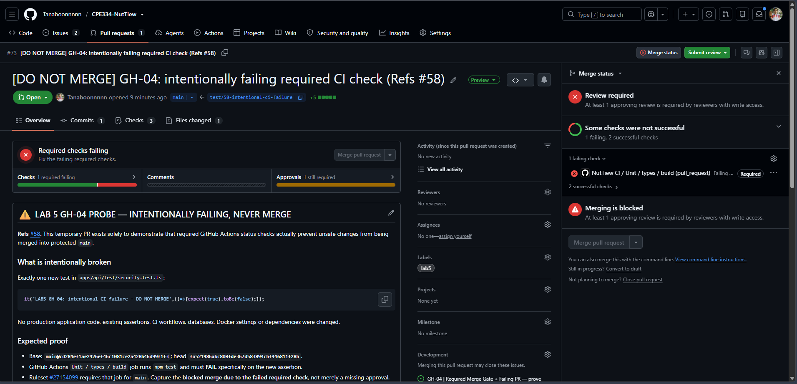
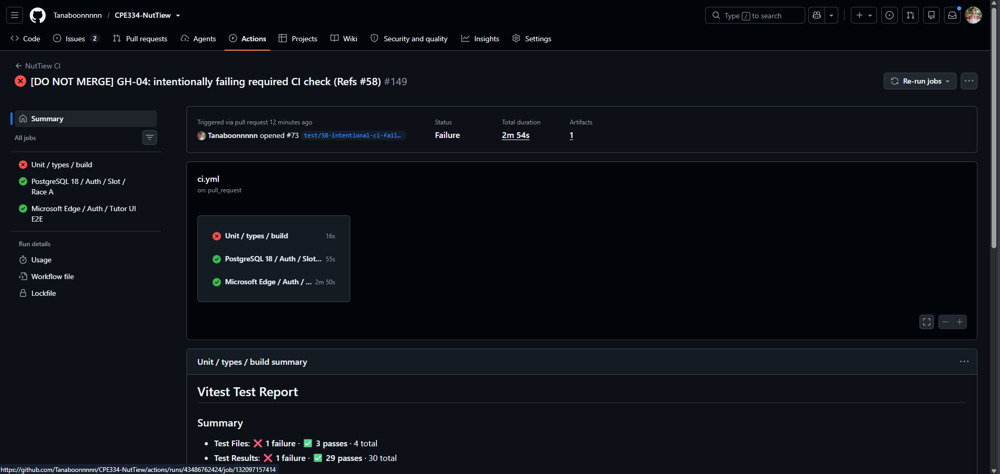
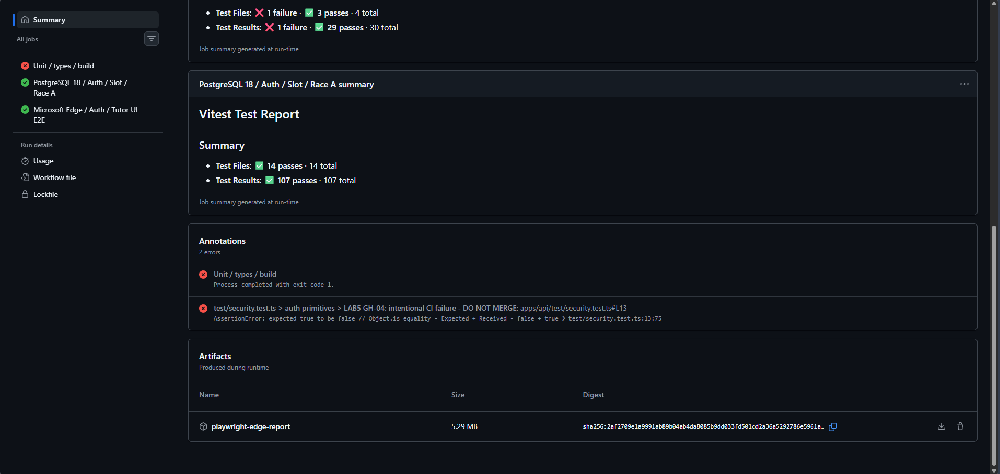

# หลักฐาน CI และการบล็อก Merge (GH-04 / Lab 5)

เอกสารนี้รวบรวมหลักฐานตามข้อ **R-05 / C-01** และ **R-06 / C-02** ของ Lab 5 สำหรับระบบ NutTiew โดยตรวจจาก Pull Request, GitHub Actions และ Ruleset จริง ภาพหน้าจอถ่ายจาก GitHub ระหว่างการทดลองวันที่ 14 พฤศจิกายน 2026 (เวลาไทย)

- Repository: [Tanaboonnnnn/CPE334-NutTiew](https://github.com/Tanaboonnnnn/CPE334-NutTiew)
- งาน: [Issue #58 (GH-04)](https://github.com/Tanaboonnnnn/CPE334-NutTiew/issues/58)
- กฎที่ใช้: [Ruleset #27154099](https://github.com/Tanaboonnnnn/CPE334-NutTiew/rules/27154099), สถานะ `active`, ครอบคลุม `main` และ `sprint1`
- Required checks: `Unit / types / build`, `PostgreSQL 18 / Auth / Slot / Race A`, `Microsoft Edge / Auth / Tutor UI E2E`
- ต้องมี Approving Review จากเพื่อนร่วมทีมอย่างน้อยหนึ่งคนด้วย

## C-01: PR งานจริงผ่าน CI และ Peer Review

[PR #72: GH-03 Docker CI](https://github.com/Tanaboonnnnn/CPE334-NutTiew/pull/72) แสดงตัวอย่างการส่งงานเข้า `sprint1` ตามขั้นตอนปกติ

| รายการ | ผลตรวจสอบ |
| --- | --- |
| Commit ที่ตรวจ | `8abfe5bb8450ec2615ae6f9f7041f0916bf9f358` |
| GitHub Actions | [Run #43458545343](https://github.com/Tanaboonnnnn/CPE334-NutTiew/actions/runs/43458545343) |
| `Unit / types / build` | ผ่าน รวมขั้น `Docker production image build (runtime target, GH-03)` และ `Compose config validation` |
| `PostgreSQL 18 / Auth / Slot / Race A` | ผ่าน |
| `Microsoft Edge / Auth / Tutor UI E2E` | ผ่าน |
| Peer Review | `Chxtamos` อนุมัติที่ commit ข้างต้น เมื่อ 13 พ.ย. 2026 เวลา 16:12 UTC |
| สถานะ PR | Merge เข้า `sprint1` แล้ว เมื่อ 13 พ.ย. 2026 เวลา 16:12 UTC |

แหล่งตรวจสอบ: [รายการ CI Jobs ของ PR #72](https://github.com/Tanaboonnnnn/CPE334-NutTiew/actions/runs/43458545343) และ [ประวัติ Review ของ PR #72](https://github.com/Tanaboonnnnn/CPE334-NutTiew/pull/72)

## C-02: ทดลองให้ Required Check ล้มเหลว

เปิด [Temporary PR #73](https://github.com/Tanaboonnnnn/CPE334-NutTiew/pull/73) จาก `test/58-intentional-ci-failure` เข้าสู่ protected branch `main` โดยเพิ่ม Test ที่ตั้งใจให้ผิดเพียงหนึ่งรายการใน `apps/api/test/security.test.ts` ไม่มีการแก้ Production Code หรือการตั้งค่า CI

| รายการ | ค่าที่ตรวจสอบ |
| --- | --- |
| Base branch | `main` ที่ `cd284ef1ae2426ef46c1081ce2a428b46d99f1f3` |
| Test probe commit | `fa521986abc808fde367d583894cbf446811f28b` |
| ชื่อ Test | `LAB5 GH-04: intentional CI failure - DO NOT MERGE` |
| ผล `npm test` | 29 API Tests ผ่าน และ Test ทดลอง 1 รายการ Fail ด้วย `expected true to be false` |
| Required Check | `Unit / types / build` เป็น `failure` เพราะขั้น `Unit tests` ล้มเหลว |
| Checks อื่น | PostgreSQL และ Microsoft Edge ผ่านทั้งคู่ |
| GitHub Actions | [Run #43486762424](https://github.com/Tanaboonnnnn/CPE334-NutTiew/actions/runs/43486762424) |
| Failed Job | [Unit / types / build (Job #132097157414)](https://github.com/Tanaboonnnnn/CPE334-NutTiew/actions/runs/43486762424/job/132097157414) |
| ผลบนหน้า PR | แสดง `Required checks failing` และปุ่ม Merge ใช้งานไม่ได้ |
| สถานะสุดท้าย | **Closed without merge** เมื่อ 13 พ.ย. 2026 เวลา 19:04 UTC; เก็บประวัติ PR และ CI ไว้ |

### ภาพที่ 1: Required Check ล้มเหลวและ Merge ถูกบล็อก

ภาพถ่ายตอน PR #73 ยังเปิดอยู่ เห็นสาเหตุ `Required checks failing` และ `Unit / types / build` เป็น Required Check ที่ Fail ทั้งยังเห็น `Review required` อีกข้อหนึ่งด้วย จึงต้องอ่านผลให้ถูกต้อง: Ruleset บังคับทั้ง **ผล Check ที่ผ่าน** และ **การอนุมัติจากผู้รีวิว** หากยังขาดข้อใดข้อหนึ่งก็ Merge ผ่านขั้นตอนปกติไม่ได้ ภาพนี้มีหลักฐานการล้มเหลวของ Required Check โดยตรง ไม่ได้อาศัยแค่ข้อความว่ารอรีวิว

### ภาพที่ 2: GitHub Actions Run ที่ล้มเหลว

CI Run จบด้วย `Failure` โดย `Unit / types / build` เป็น Job เดียวที่ Fail ส่วน `PostgreSQL 18 / Auth / Slot / Race A` และ `Microsoft Edge / Auth / Tutor UI E2E` ผ่าน จึงแยกความล้มเหลวที่ตั้งใจทดลองออกจากการทำงานของ Job อื่นได้

### ภาพที่ 3: Assertion ที่ทำให้ Fail จริง

ส่วน `Annotations` ระบุไฟล์ `apps/api/test/security.test.ts` บรรทัด 13 และข้อความ `AssertionError: expected true to be false` ตรงกับ Test ทดลองที่เพิ่มไว้ ไม่ใช่ปัญหา Docker, การเชื่อมฐานข้อมูล หรือระบบจองคิว

## ความปลอดภัยและผลลัพธ์สุดท้าย

- PR #73 ตั้งใจใช้เป็น Negative Control เท่านั้น และ **ปิดโดยไม่ Merge** เมื่อเก็บภาพแล้ว Commit ที่ตั้งใจให้ Test Fail ไม่เข้าสู่ `main` หรือ `sprint1`
- Ruleset ยังคงบังคับสาม Required Checks และ Human Approval ไม่ได้เปลี่ยนกฎหรือลดเงื่อนไขเพื่อให้ผ่าน
- Branch `chore/58-merge-gate-proof` สำหรับเอกสารนี้เริ่มจาก `origin/sprint1` โดยแยกออกจาก Branch ทดลองอย่างเด็ดขาด มีเพียง Markdown และรูปภาพหลักฐาน ไม่มี Test ที่ตั้งใจให้ Fail
- การทดลอง GH-04 นี้เป็นงาน GitHub เท่านั้น ไม่มีการใช้งาน GCP, Billing, Cloud SQL, Docker Volume หรือ Deployment

**ขอบเขตของหลักฐาน:** ภาพหน้าจอบันทึกสถานะ GitHub ขณะ PR ยังเปิด และตรวจสอบย้อนหลังผ่าน URL กับ Commit SHA ได้ หลังจากนั้น PR ถูกปิดโดยไม่ Merge แล้ว เอกสารนี้ยืนยันว่าการทดสอบแบบ Negative Control ถูกบล็อกภายใต้ Ruleset ที่เปิดใช้งานในเวลาทดลอง ไม่ใช่การทดสอบการ Bypass สิทธิ์ผู้ดูแลระบบ
